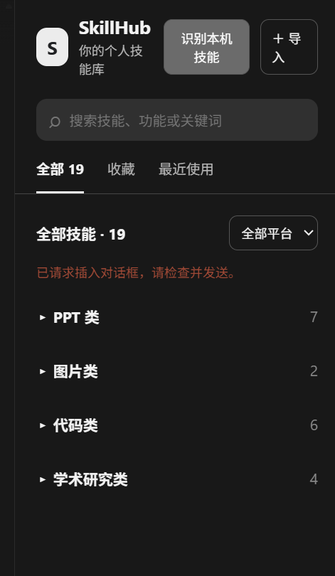

# SkillHub

SkillHub 是一个用于浏览和整理个人 Skill 的工具，提供 ChatGPT／Codex 桌面应用的 MCP 插件开发预览，以及 Chrome／Edge 浏览器扩展。它支持查看功能介绍、搜索、分类和收藏，并将简短的调用请求插入对话。

## 下载

前往 [v0.1.0 发布页面](https://github.com/song006-stack/skillhub/releases/tag/v0.1.0)下载浏览器扩展包或桌面插件包（链接将在 Release 发布后生效）。普通用户请先阅读 [中文安装指南](docs/安装指南-v0.1.0.md)。

## 界面截图



*实际界面的早期版本截图，展示分类浏览；按钮布局及提示文字可能与当前版本不同。*

## 功能

| 功能 | 桌面插件 | 浏览器扩展 |
| --- | --- | --- |
| 按名称、说明搜索；分类、收藏与最近使用 | 支持 | 支持 |
| 导入本地文件夹及 `SKILL.md` | 支持 | 支持 |
| 识别本机 Skill 目录 | 手动触发扫描常用目录 | 选择并授权目录后重新识别；浏览器可能要求重新授权 |
| 平台标记和筛选 | 支持手动标记，旧推测结果显示为待确认 | 支持基于关键词推测和手动编辑 |
| 相同技能合并展示 | 支持 | 支持 |
| 中文、英文和自定义语言文件 | 支持 | 暂不支持 |
| 导入公开 GitHub 仓库 | 暂不支持 | 支持默认分支 |
| 插入调用请求 | 请求宿主插入对话草稿 | 支持插入或请求立即发送 |

分类、简短中文介绍和浏览器版平台标记使用关键词规则推测，可以手动修改。两个版本使用独立存储，数据不会自动同步。

## 安装与运行

### 浏览器扩展

1. 获取本仓库源码并解压。
2. 在 Edge 打开 `edge://extensions`，或在 Chrome 打开 `chrome://extensions`。
3. 开启开发者模式，点击“加载解压缩的扩展”，选择**包含 `manifest.json` 的项目根目录**。
4. 打开或刷新 [ChatGPT 网页](https://chatgpt.com/)，点击浏览器工具栏中的 SkillHub 图标，打开侧边栏。

浏览器版本不需要构建；它通过页面兼容层与 ChatGPT 输入框交互，页面结构改变时可能需要适配。

### ChatGPT／Codex 桌面应用插件（开发预览）

桌面插件通过本地 MCP 服务运行，需要 Node.js 20 或更高版本，并且桌面应用启动的环境能在 `PATH` 中找到 `node`。在项目根目录执行：

```powershell
npm ci
npm run build:desktop
npm test
```

构建会生成 `desktop-plugin/server.cjs` 和 `desktop-plugin/panel.html`。将 `desktop-plugin` 作为本地插件源，通过目标桌面客户端支持的插件安装流程安装；或将该目录中 `plugin.json`、`mcp.json` 和上述两个构建产物按官方流程打包为私有插件。安装入口及本地执行能力取决于账号和客户端支持情况，不能保证所有 ChatGPT 版本都能使用。无需将 `node_modules` 放入插件包。

详细说明见 [桌面版 README](desktop-plugin/README.md)。官方参考：[插件打包](https://developers.openai.com/plugins/build/plugins)、[插件扩展](https://developers.openai.com/plugins/build/extensions)。

## 使用方法

1. 打开 SkillHub。在桌面版点击“识别本机”，可扫描当前用户目录下的 `.codex/skills` 和 `.agents/skills`；也可点击“导入”选择技能文件夹。浏览器版在“导入与设置”中可选择并记住已授权目录，之后在授权有效时重新识别；也可手动导入本地文件夹、单个 `SKILL.md`，或公开 GitHub 仓库。
2. 使用搜索框或分类查找技能；点击星标收藏，点击名称查看及编辑资料。
3. 点击“插入”，将类似“请帮我调用 dashi-ppt Skill”的简短请求放入当前对话，再补充任务并发送。
4. 桌面版点击“语言”，可切换中英文，或导入参考 [语言文件示例](desktop-plugin/language-example.json) 编写的 JSON 文件。缺失的翻译回退到中文，技能本身的名称和介绍不会自动翻译。

**平台筛选不是可用性检测。** 桌面版的 ChatGPT／Codex 筛选使用用户确认的标记，并包含标记为通用的技能；未确认的技能不会被当作已确认。当前项目无法验证某个技能是否已在当前会话安装、启用或可调用。

## 数据、安全与限制

- 桌面版手动导入会将所选文件保存到应用本地存储；识别本机目录只读取技能说明，其他资源保留在原目录。浏览器版手动导入的文件保存在本机扩展存储中；记住目录时只保存技能说明和目录访问句柄，相关资源保留在原目录。浏览器重启后可能需要重新授权；不支持目录访问接口时可继续手动导入。请保留原始文件备份，当前没有资源导出界面。
- SkillHub 不会自动执行导入的脚本。调用只插入简短请求，不会自动附加 `SKILL.md` 或其他资源，也不等于安装或激活原生 Skill。
- GitHub 导入只支持浏览器版的公开仓库默认分支，受网络及匿名速率限制；目前上限为 500 个文件、20 MB。
- 桌面版的 GitHub 导入、多技能组合调用和浏览器数据迁移尚未实现。
- 导入第三方 Skill 前请检查其说明；只有在明确授权且运行环境支持时才应执行其脚本。

## 开发和验证

`npm ci` 安装构建与测试依赖；`npm run build:desktop` 构建桌面插件；`npm test` 执行核心逻辑、MCP 协议及模拟界面测试。真实客户端的安装、文件选择和消息插入还需要在目标环境中验证。

## 版本和许可证

参见 [版本说明](CHANGELOG.md) 和 [MIT License](LICENSE)。桌面插件和浏览器扩展分别使用各自清单中的版本号。
